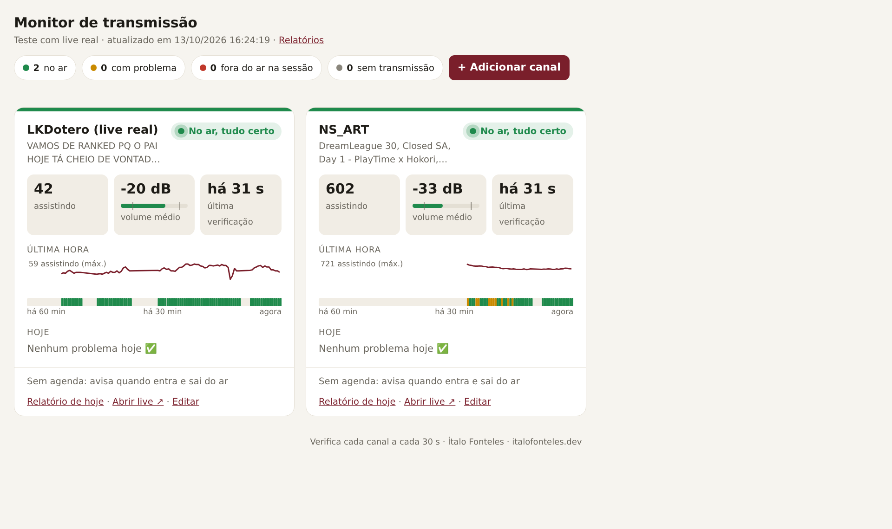
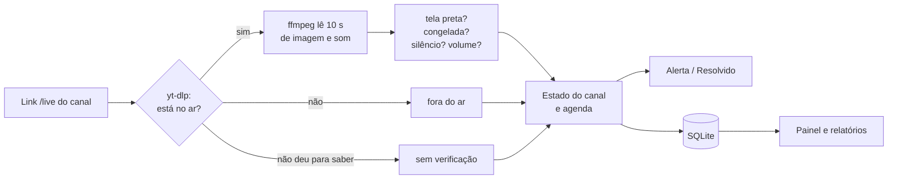
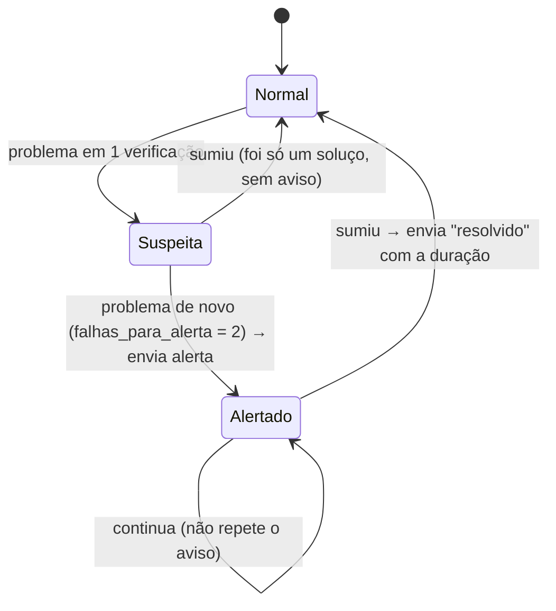

# Monitor de Transmissão

Vigia **transmissões ao vivo** no YouTube, no Facebook ou num servidor próprio, e **avisa na hora** pelo Telegram ou WhatsApp quando algo dá errado:

| Problema | Exemplo de aviso |
|---|---|
| A sessão não começou no horário | 🔴 Câmara Municipal: a sessão estava marcada para 09:00 e a transmissão ainda não está no ar |
| A transmissão caiu | 🔴 Câmara Municipal: transmissão fora do ar desde 10:42 |
| Tela preta | ⬛ Câmara Municipal: tela preta desde 10:15 |
| Imagem congelada | 🧊 Câmara Municipal: imagem congelada desde 11:03 |
| Sem áudio (encoder ou mesa mutada) | 🔇 Câmara Municipal: sem áudio desde 10:20 |
| Silêncio por vários minutos | 🤫 Câmara Municipal: silêncio prolongado desde 10:31 |
| Áudio estourando | 📢 Câmara Municipal: áudio estourando (volume muito alto) desde 09:31 |

Quando o problema some, chega o aviso de **resolvido** com a duração ("✅ sem áudio resolvido às 10:23 (durou 3 min)"). No fim de cada sessão sai um **relatório**: tempo no ar, quedas, problemas e audiência, com gráfico.

**Para quem:** câmaras municipais, assembleias, igrejas, produtoras de eventos e escolas, ou seja, quem transmite e precisa saber de uma falha **antes** de alguém reclamar.

**Stack:** Python 3.12 · ffmpeg · yt-dlp · SQLite · Docker. Não precisa de chave de API do YouTube.



*Painel vigiando duas lives reais do YouTube. Cada cartão mostra a situação, quantos assistem, o medidor de volume, a linha do tempo da última hora e os problemas do dia. Canais e horários se cadastram em "+ Adicionar canal".*

---

## Sumário

1. [Como funciona](#como-funciona)
2. [Instalação](#instalação)
3. [Configuração](#configuração)
4. [Alertas no celular](#alertas-no-celular)
5. [Painel e relatórios](#painel-e-relatórios)
6. [Consumo de internet](#consumo-de-internet)
7. [Limitações](#limitações)
8. [Estrutura do código e testes](#estrutura-do-código-e-testes)

---

## Como funciona

A cada `intervalo_segundos` (padrão: 60 s), o monitor faz o mesmo ciclo para cada canal:



### 1. Está no ar?

O [yt-dlp](https://github.com/yt-dlp/yt-dlp) consulta o link **`/live` do canal** (por exemplo `https://www.youtube.com/@camara/live`), que sempre aponta para a transmissão atual. Ele responde:

- se o canal está **ao vivo** agora;
- o **título** da live e **quantas pessoas estão assistindo**;
- os endereços do vídeo. O YouTube manda **imagem e som em trilhas separadas**, então o monitor pega a imagem em 360p (suficiente para analisar) e o áudio.

Se o yt-dlp disser "o canal não está ao vivo", o canal está **fora do ar**. Se der outro erro (YouTube fora, internet caída, pedido de login), o resultado é **"não consigo verificar"**. São coisas diferentes, e o monitor não confunde uma falha dele com queda da transmissão.

Endereços diretos (`.m3u8`, `rtmp://`, `srt://`), como o servidor de transmissão da própria câmara, vão direto para o próximo passo.

### 2. Imagem e som

O **ffmpeg** lê `amostra_segundos` (padrão: 10 s) da live e passa por quatro detectores que já vêm com ele:

| Detector do ffmpeg | O que procura | Quando vira problema |
|---|---|---|
| `blackdetect` | quadros quase pretos | tela preta em ≥ 60% da amostra |
| `freezedetect` | imagem que não muda por 2 s ou mais | congelada em ≥ 60% da amostra |
| `volumedetect` | pico do som | pico abaixo de −70 dB, ou sem trilha de áudio = **sem áudio (mudo)** |
| `silencedetect` | som abaixo de `silencio_db` (−50 dB) | silêncio em ≥ 80% da amostra = **silêncio prolongado** (veja abaixo) |
| `volumedetect` | volume médio | volume médio acima de `volume_alto_db` (−8 dB) = áudio estourando |

A regra dos 60% evita alarme por um corte de câmera.

**Mudo × silêncio.** Toda transmissão tem pausas: votação, troca de orador, narrador calado. Num teste com uma live real de campeonato, os narradores ficaram quietos por 3 a 10 segundos várias vezes, e numa amostra inteira o som ficou abaixo de −50 dB. Por isso são dois problemas diferentes:

| | Como reconhece | Quando avisa |
|---|---|---|
| 🔇 **Sem áudio** | **nenhum sinal**: pico abaixo de −70 dB ou sem trilha de áudio. É o encoder que perdeu o som ou a mesa que ficou mutada. | rápido: depois de `falhas_para_alerta` verificações (1 a 2 min) |
| 🤫 **Silêncio prolongado** | há sinal, mas baixo, em ≥ 80% da amostra. Pode ser ninguém falando ou um microfone muito baixo. | só se durar **`minutos_silencio`** (padrão: 5 min) seguidos. Uma fala no meio zera a contagem. |

### 3. Estado do canal: quando avisar

Cada canal tem uma pequena "memória" ([`app/estado.py`](app/estado.py)):



- **Um problema só vira alerta depois de N verificações seguidas** (`falhas_para_alerta`, padrão 2). Com verificação a cada minuto, o aviso chega em cerca de 1 a 2 minutos.
- **O aviso não se repete** enquanto o problema continua. Quando some, chega um único "resolvido".
- **"Não consigo verificar" não apaga os outros problemas.** Se a tela estava preta e o YouTube parou de responder, o monitor não diz que a tela preta foi resolvida.
- Tudo vira **incidente** no banco, com início e fim, para o relatório.

### 4. Agenda das sessões

A agenda é o que separa "a transmissão caiu" de "a sessão acabou".

| Situação | Com agenda | Sem agenda |
|---|---|---|
| Fora do ar **antes** do horário | normal | — |
| Fora do ar depois do início + `tolerancia_inicio_minutos` | 🔴 **"não começou"** | — |
| Estava no ar e saiu, **dentro** da sessão | 🔴 **"caiu"** | — |
| Saiu do ar **fora** da sessão / sem agenda | ⚪ "transmissão encerrada" (informativo) | ⚪ "transmissão encerrada" |
| Fim da sessão marcada | 📋 **relatório da sessão** | — |
| A live encerrou | — | 📋 **relatório da transmissão** |

Problemas de imagem e som (tela preta, sem áudio…) são avisados sempre que a live está no ar, com ou sem agenda.

### 5. Relatório

No fim de cada sessão, o monitor gera um HTML ([`app/relatorio.py`](app/relatorio.py)), salva em `/dados/relatorios/` e manda pelo Telegram, com um resumo na legenda:

```
📋 Relatório · Câmara Municipal
14/10 09:00 – 12:00
No ar: 97% do tempo
🔴 transmissão fora do ar: 4 min
🔇 sem áudio: 2 min
👥 Audiência: pico 213, média 148
```

O HTML traz os números principais, o **gráfico de audiência com a faixa de situação** minuto a minuto e a **tabela de problemas**. Para virar PDF, abra no navegador e use Ctrl+P → Salvar como PDF.

---

## Instalação

Precisa de um computador ligado durante as sessões, com **Docker**. Pode ser:
- o próprio computador da transmissão;
- um **mini PC** com Linux na rede da câmara (recomendado: fica ligado 24 h e não depende de ninguém);
- um servidor.

```bash
git clone https://github.com/ItaloFonteles/monitor-transmissao.git
cd monitor-transmissao
cp .env.example .env
cp config.exemplo.toml config.toml     # já vem com uma transmissão simulada para testar
docker compose up -d --build
```

- **Painel:** http://localhost:8095. Em outro computador da rede: `http://IP-DO-MONITOR:8095`.
- **Log com os alertas:** `docker compose logs -f monitor`.

Com `MODO_TESTE=true` (o padrão), os alertas aparecem **só no log**. Configure o Telegram e mude para `false` para receber no celular.

### Testar sem uma live real

O canal `url = "simulado"` é uma **live de mentira** gerada pelo ffmpeg. Num ciclo de 8 minutos ela fica normal, **preta**, **muda**, **congelada** e **cai**, e depois volta. Serve para conferir que os alertas chegam no celular e para **demonstrar o monitor a um cliente** em poucos minutos.

---

## Configuração

### Canais: pelo painel, sem mexer em código

No painel, clique em **"+ Adicionar canal"**, ou em **"Editar"** no cartão de um canal:

1. **Nome:** por exemplo "Câmara Municipal de Boa Vista".
2. **Link da transmissão:** cole o canal do jeito que tiver, como `@camara`, `youtube.com/@camara` ou `youtube.com/@camara/videos`. O painel completa sozinho para o link **`/live`**.
3. **Testar link:** consulta o YouTube na hora e mostra se está ao vivo, o título e quantos assistem.
   - Se você colar o link de **um vídeo** (`watch?v=…`), que muda a cada transmissão, o painel avisa e **sugere o link `/live` do canal** dono do vídeo. É só clicar para usar.
4. **Horários das sessões** (opcional): marque os dias e o horário. Dá para ter mais de um horário, por exemplo terça a quinta de manhã e segunda à noite.
5. **Salvar.** O monitor passa a usar o canal **na próxima verificação, sem reiniciar**.

Para trocar a live vigiada, edite o link. O estado do canal recomeça do zero, sem alertas "resolvido" falsos da live anterior. **Remover canal** apaga o canal da lista, mas o histórico e os relatórios continuam guardados.

Os canais ficam em `/dados/canais.json`, dentro do volume do Docker, e continuam lá depois de reiniciar ou atualizar o monitor. Na **primeira** vez, a lista vem do `config.toml`; depois disso, quem manda é o painel.

**Senha do painel:** como o painel altera os canais, defina `PAINEL_SENHA=…` no `.env`. O navegador vai pedir usuário e senha: o usuário pode ser qualquer um, a senha é essa.

### Pelo `config.toml`

Os ajustes gerais ficam no `config.toml`. Os canais também podem ficar nele, e servem como lista inicial:

```toml
[geral]
cliente = "Câmara Municipal de Exemplo"

[[canais]]
nome = "Câmara Municipal"
url = "https://www.youtube.com/@NOME_DO_CANAL/live"
agenda = [
  { dias = ["ter", "qua", "qui"], inicio = "09:00", fim = "13:00" },
  { dias = ["seg"], inicio = "18:00", fim = "21:00" },
]

[[canais]]
nome = "Igreja (cultos)"
url = "https://www.youtube.com/@igreja/live"     # sem agenda: avisa quando entra e sai do ar
```

**Como achar o link do canal:** abra o canal no YouTube. O endereço é `youtube.com/@nome`; acrescente `/live` no fim. **Não use o link de um vídeo** (`watch?v=…`): ele muda a cada transmissão.

**Dias:** `seg`, `ter`, `qua`, `qui`, `sex`, `sab`, `dom`. Sem `dias`, vale todos os dias. O monitor avisa com uma mensagem clara se algo estiver digitado errado.

**Ajustes em `[geral]`:**

| Opção | Padrão | Para quê |
|---|---|---|
| `intervalo_segundos` | 60 | de quanto em quanto tempo verificar cada canal |
| `amostra_segundos` | 10 | quantos segundos de vídeo analisar a cada vez |
| `falhas_para_alerta` | 2 | verificações seguidas com problema antes de avisar |
| `tolerancia_inicio_minutos` | 10 | atraso aceito no começo da sessão antes do "não começou" |
| `avisar_inicio_e_fim` | true | avisar quando a transmissão entra e sai do ar |
| `silencio_db` | −50 | abaixo disso é silêncio (suba para −45 se o ambiente for muito ruidoso) |
| `volume_alto_db` | −8 | volume médio acima disso é "áudio estourando" |
| `minutos_silencio` | 5 | tempo de silêncio (com sinal) antes do aviso de "silêncio prolongado" |

Depois de mudar o `[geral]`, rode `docker compose restart`. Canais adicionados no `config.toml` depois que o painel já foi usado não entram sozinhos: cadastre pelo painel, ou apague o `canais.json` do volume para recomeçar pelo `config.toml`.

---

## Alertas no celular

Tudo isso vai no arquivo `.env`.

**Telegram (recomendado, grátis):**
1. No Telegram, fale com o **@BotFather**, mande `/newbot` e copie o **token**.
2. Mande qualquer mensagem para o seu bot e depois fale com o **@userinfobot** para descobrir o seu **chat_id**. Para um grupo da equipe, adicione o bot ao grupo e use o id do grupo.
3. No `.env`, coloque `TELEGRAM_TOKEN=…`, `TELEGRAM_CHAT_ID=…` e `MODO_TESTE=false`, depois rode `docker compose up -d`.

**WhatsApp:** em `WEBHOOK_URL`, coloque o endereço de um fluxo do **n8n**, ou de outro sistema, que recebe o alerta em JSON (`{"texto": "...", "canal": "...", "problema": "...", "situacao": "alerta"}`) e envia pelo WhatsApp, por exemplo com a Evolution API.

**Sinal de vida (opcional):** em `HEARTBEAT_URL`, coloque um endereço do [healthchecks.io](https://healthchecks.io). Se o computador do monitor desligar ou ficar sem internet, é o healthchecks que avisa você.

Uma falha no envio nunca derruba o monitor: o erro fica no log e ele continua verificando.

---

## Painel e relatórios

Abra **http://localhost:8095**. A página se atualiza sozinha a cada 10 segundos.

- **No topo:** quantos canais estão no ar, com problema, fora do ar na sessão e sem transmissão.
- **Um cartão por canal:**
  - situação com cor: 🟢 no ar · 🟡 com problema · 🔴 fora do ar na sessão · ⚪ sem transmissão;
  - título da live, **quantos assistem**, **medidor de volume** (com marcas de silêncio e estouro) e há quanto tempo foi a última verificação;
  - **linha do tempo da última hora**: uma faixa colorida minuto a minuto e a curva de audiência;
  - **problemas de hoje**, com horário de início e fim;
  - agenda, **próxima sessão** e links para o relatório do dia e para a live;
  - aviso em vermelho se o próprio monitor parar de verificar.
  - **Editar**: muda o nome, o link ou os horários, ou remove o canal.
- **"+ Adicionar canal"**, com o "Testar link" (veja [Configuração](#configuração)).
- **Relatórios:** a lista de todas as sessões encerradas, em `/relatorios`.

Proteja o painel com `PAINEL_SENHA` e deixe a porta 8095 acessível só na rede interna, nunca exposta direto na internet. Para acompanhar de fora, use uma VPN, como o WireGuard, ou o Tailscale.

---

## Consumo de internet

Cada verificação baixa a amostra em 360p, cerca de **1,5 a 2 MB** para 10 s.

| Verificação | Por hora | Sessão de 4 h |
|---|---|---|
| a cada 60 s | ~110 MB | ~450 MB |
| a cada 30 s | ~220 MB | ~900 MB |

Fora da agenda, se a live não está no ar, a consulta é só a página do YouTube (alguns KB). Na mesma rede da transmissão, prefira 60 s para não disputar banda com o envio da live.

---

## Limitações

- **O YouTube muda com frequência**, e o yt-dlp precisa acompanhar. Reconstrua a imagem uma vez por mês para atualizar: `docker compose build --pull && docker compose up -d`. Se o painel mostrar "não consigo verificar" em todos os canais do YouTube, comece por aí.
- **Em servidores na nuvem**, o YouTube às vezes pede "confirme que você não é um robô". Rodando na rede da própria câmara (internet residencial ou empresarial), isso é raro.
- **Qualidade fina não é detectada:** eco, chiado, microfonia, imagem desfocada ou câmera apontando para o lugar errado. O monitor pega o que **impede** de assistir (queda, preto, congelado, mudo, estourado).
- **Atraso do aviso:** cerca de `intervalo_segundos × falhas_para_alerta` (1 a 2 minutos com o padrão).
- **Facebook:** funciona pelo yt-dlp quando a live é pública, mas é menos estável que o YouTube.

---

## Estrutura do código e testes

```
monitor-transmissao/
├── app/
│   ├── main.py        # laço principal: verifica, decide alertas, fecha sessões
│   ├── fonte.py       # está no ar? (yt-dlp, endereço direto ou live simulada)
│   ├── analise.py     # ffmpeg: tela preta, congelada, silêncio e volume
│   ├── estado.py      # quando avisar e quando dizer "resolvido"
│   ├── config.py      # leitura do config.toml, da agenda e validação de canais
│   ├── canais.py      # cadastro de canais pelo painel (/dados/canais.json)
│   ├── alertas.py     # Telegram, webhook e sinal de vida
│   ├── banco.py       # histórico em SQLite (verificações e incidentes)
│   ├── relatorio.py   # relatório da sessão (HTML com gráfico)
│   ├── painel.py      # painel ao vivo e lista de relatórios
│   └── rotulos.py     # nomes e ícones dos problemas
├── tests/            # test_monitor.py e test_painel.py
├── config.exemplo.toml
├── docker-compose.yml
└── Dockerfile         # Python + ffmpeg + yt-dlp
```

```bash
docker compose run --rm --no-deps monitor python -m unittest -v
```

34 testes cobrem:
- a leitura do ffmpeg (tela preta, congelada, **mudo × silêncio** com o caso real da live de campeonato, volume, trecho sem fim, vídeo que não abre);
- o **ffmpeg de verdade** sobre a live simulada;
- a agenda e as mensagens de erro do `config.toml`;
- a lógica de alertas (só depois de N falhas, silêncio só depois de minutos, soluço não alerta, "não consigo verificar" não apaga outros problemas, fim normal não é queda);
- uma **manhã de sessão simulada minuto a minuto** (atraso no início, falta de áudio, queda e relatório no fim);
- uma live sem agenda (início, fim e relatório);
- o relatório, o painel (próxima sessão, aviso de monitor parado) e a lista de relatórios;
- os links do YouTube (completar com /live, reconhecer link de vídeo);
- o cadastro pelo painel (criar, editar, renomear, remover, erros e gravação no arquivo);
- trocar e adicionar canais **com o monitor rodando**;
- as rotas do painel de verdade (salvar, testar link, remover, só JSON) e a senha.

Também foi testado com lives reais do YouTube.

---

Feito por **Ítalo Fonteles** · [italofonteles.dev](https://italofonteles.dev) · contato@italofonteles.dev
